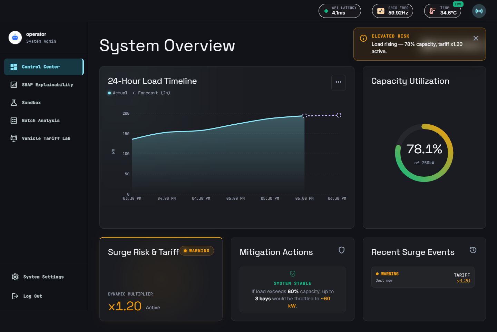
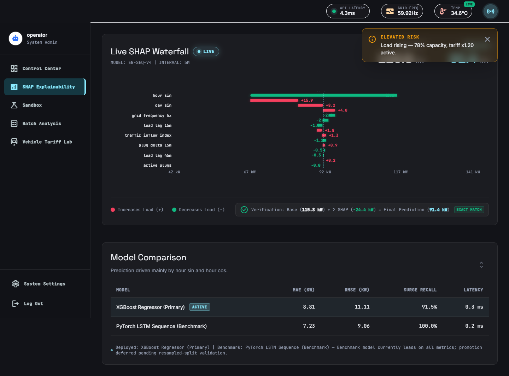
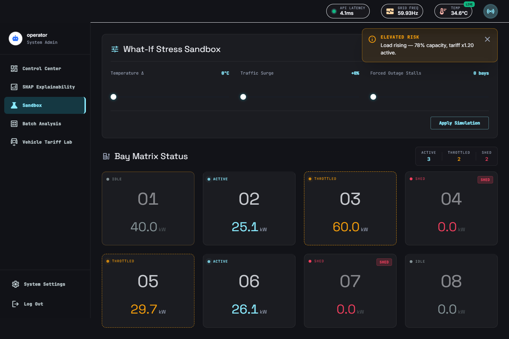
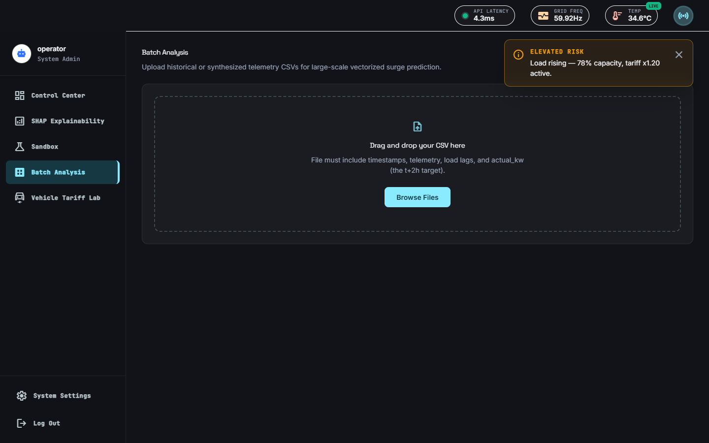
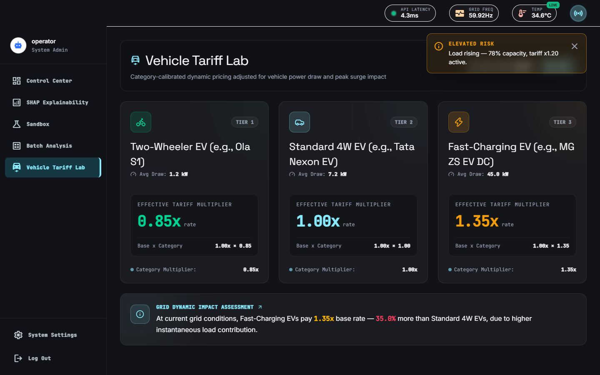
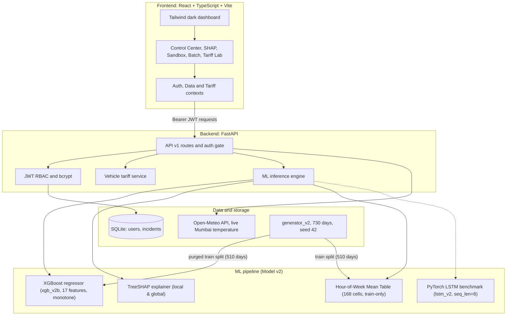

<div align="center">

# ⚡ EV Surge Predictor — Grid Pulse

**Predict EV charging load 2 hours ahead. Explain every prediction. Protect the transformer before it overloads.**

[](https://github.com/soham-88/ev-surge-predictor/actions/workflows/ci.yml)
[](https://react.dev/)
[](https://www.typescriptlang.org/)
[](https://fastapi.tiangolo.com/)
[](https://xgboost.readthedocs.io/)
[](https://pytorch.org/)
[](https://tailwindcss.com/)
[](LICENSE)

[Overview](#-overview) · [Screenshots](#-screenshots) · [Features](#-features) · [Architecture](#-architecture) · [Model Results](#-model-results) · [Data Transparency](#-data-transparency) · [Setup](#-local-setup) · [API](#-api-reference) · [Team](#-team)

</div>

---

## 🎯 Overview

Commercial EV charging stations can draw enough power in a short window to overload their transformer. **Grid Pulse** is a full-stack system that forecasts station load **2 hours ahead**, explains *why* the model predicted it, and recommends (or simulates) protective actions such as dynamic tariffs, bay throttling, and load shedding.

| | |
|---|---|
| **Problem** | Sudden EV charging surges can breach the 250 kW transformer limit |
| **Solution** | 2-hour-ahead forecasting, surge risk banding, explainable predictions, and demand-response tariffs |
| **Models** | Monotonic XGBoost (deployed) with TreeSHAP, PyTorch LSTM (benchmark) |
| **Stack** | React 19 + TypeScript + Tailwind, FastAPI, SQLite, JWT auth |
| **Context** | Commercial EV Depot 2-Hour Demand Response & Overload Protection |

**Surge risk bands (against 250 kW capacity):** 🟢 Normal below 65% (1.00x) · 🟡 Warning 65 to 80% (1.20x) · 🔴 Critical 80 to 95% (1.45x) · ⚠️ Severe ≥95% (1.80x)

---

## 📸 Screenshots

### Control Center: live forecast, capacity gauge, surge risk and tariff


### SHAP Explainability: why the model predicted this number


### Sandbox: what-if stress testing


### Batch Analysis: CSV upload and bulk 2-hour-ahead prediction


### Vehicle Tariff Lab: category-based demand-response pricing


---

## 🚀 Features

### 1. Control Center
- Load Timeline (2h history + 2h forecast) with actual load and a 2-hour-ahead forecast
- **Empirical 80% Prediction Interval** (calibrated validation-split binned quantiles: `<100 kW` [-19.7, +18.7], `100–160 kW` [-19.7, +20.7], `≥160 kW` [-23.0, +22.3] kW) overlaid with dynamic bounds
- **Live Telemetry Scenario Switcher**: Nominal Midday, Evening Commute (Rush Hour), Summer Heatwave Peak (Critical), and Monsoon Lull
- Capacity utilization gauge against the 250 kW transformer limit
- Surge risk status with dynamic tariff multipliers (1.00x, 1.20x, 1.45x, 1.80x)
- Mitigation panel showing throttled bays (capped at 60 kW per stall), or a readiness preview when load is normal
- **Persistent SQLite Incident Log** tracking past surge alerts and mitigations

### 2. SHAP Explainability
- **Local Attribution (Waterfall)**: TreeSHAP waterfall from base value to final prediction, one bar per feature
- **Global Feature Importance**: Dataset-wide mean absolute SHAP attributions ($E[|\phi_j|]$) ranking all 17 drivers by predictive power
- Additivity check in the UI: base value + sum of 17 SHAP values = model prediction
- Auto-generated sentence naming the top contributing drivers
- XGBoost vs LSTM comparison table (MAE, RMSE, surge recall, latency)

### 3. Sandbox (what-if simulation)
- Sliders for temperature change, traffic surge percentage, and forced stall outages (0 to 8 bays)
- Backend simulation returns baseline vs simulated load and the mitigation dispatched
- 8-bay status matrix: Active, Throttled, Shed, Idle
- Control Center switches to a clearly marked "Simulation Active" view while a scenario is applied

### 4. Batch Analysis
- Upload a telemetry CSV and get vectorized predictions for every row
- Summary stats, actual vs predicted chart (aligned to the 2-hour horizon), and a results table
- Download the annotated results as CSV

### 5. Vehicle Tariff Lab
Demand-response pricing by vehicle category, linked to the current surge state:

| Tier | Vehicle | Multiplier | Average draw |
|---|---|---|---|
| 1 | Two-wheeler EV | 0.85x | 1.2 kW |
| 2 | Standard 4W EV | 1.00x | 7.2 kW |
| 3 | DC fast charging | 1.35x | 45 kW |

### 6. Security and reporting
- JWT authentication (HS256) with bcrypt password hashing
- Role-based access control: **Operator** (full access) and **Viewer** (read-only), enforced on the backend and not only hidden in the UI
- One-click PDF report of the dashboard snapshot

---

## 🏗️ Architecture



---

## 📊 Model Results

Evaluated on the held-out test split (110 days, stratified by day type, with boundary purge ensuring no lag window or target crosses split days).

### 1. Benchmark Forecaster Comparison (Full Test Split: 9,480 Timestamps)

| Model | MAE | RMSE | Rule A Rec ($\ge 200\text{ kW}$) | Rule A Prec | Rule B Rec ($\ge 162.5\text{ kW}$) | Rule B Prec |
|---|---|---|---|---|---|---|
| **Persistence** ($\text{lag}_{15\text{m}}$) | 40.30 kW | 49.24 kW | 30.9% | 30.9% | 57.0% | 26.9% |
| **Plain Hour-of-Week Mean** | 20.28 kW | 25.38 kW | 71.4% | 75.0% | 93.2% | 55.8% |
| **Baseline 3** (AR(1) Anomaly) | 14.51 kW | 18.17 kW | 63.7% | **89.5%** | 97.8% | **57.2%** |
| **XGBoost** (`xgb_v2b`, deployed) | **12.65 kW** | **15.90 kW** | **81.9%** | 84.7% | 99.6% | 49.7% |

### 2. XGBoost vs. LSTM Benchmark Comparison (9,210 Aligned Test Sequences)

Evaluated on the exact same 9,210 sequence-aligned test instances (requiring an 8-step past history window) from `saved_models/training_metrics.joblib` and `lstm_metrics.joblib`:

| Model | MAE | RMSE | Rule A Rec ($\ge 200\text{ kW}$) | Rule A Prec | Rule B Rec ($\ge 162.5\text{ kW}$) | Rule B Prec | Latency (Model-Only) | Latency (End-to-End) |
|---|---|---|---|---|---|---|---|---|
| **XGBoost** (`xgb_v2b`, deployed) | **12.67 kW** | **15.93 kW** | **81.9%** | 84.7% | 99.6% | 49.3% | 1.15 ms | 6.3 ms |
| **PyTorch LSTM** (`lstm_v2`, benchmark) | 12.94 kW | 16.32 kW | 78.8% | **86.4%** | **99.7%** | 48.7% | **0.20 ms** | **0.44 ms** |

*Why XGBoost is deployed for live serving:*
- Accuracy is comparable between both models on the same test set (12.67 kW vs 12.94 kW MAE), with XGBoost achieving slightly higher Rule A surge recall (81.9% vs 78.8%).
- XGBoost provides exact, real-time TreeSHAP local attributions ($\sum \phi_j = \hat{y} - \phi_0$) for operators.
- XGBoost supports mathematically enforced monotone constraints to prevent counter-intuitive forecast drops during load surges.
- XGBoost enables stateless single-row HTTP inference without maintaining a multi-step sequence buffer in memory.

### Alert Rule Definitions
- **Rule A (Surge Alert / Critical)**: Actual or forecast load $\ge 200.0\text{ kW}$ (80% of 250 kW transformer capacity). Triggers automated throttling and critical tariff escalation. High precision (84.7%) avoids disruptive false alarms.
- **Rule B (Early Warning / Advisory)**: Forecast load $\ge 162.5\text{ kW}$ (65% of 250 kW transformer capacity). Intentionally calibrated for ultra-high recall (99.6%) to give operators a 2-hour lead time before a potential overload occurs.

### Prediction Interval Calibration
An empirical 80% prediction interval is calibrated on validation residuals across 3 load regimes:
- **$< 100\text{ kW}$**: $[-19.69\text{ kW}, +18.71\text{ kW}]$ (width: 38.40 kW, test coverage: 80.34%)
- **$100\text{ to } 160\text{ kW}$**: $[-19.67\text{ kW}, +20.71\text{ kW}]$ (width: 40.37 kW, test coverage: 78.97%)
- **$\ge 160\text{ kW}$**: $[-23.00\text{ kW}, +22.32\text{ kW}]$ (width: 45.32 kW, test coverage: 79.51%)
- **Overall Coverage**: **79.78%** on held-out test data (within $\pm 3\text{ pp}$ of 80% target).

### Monotone Property
Partial monotonicity is enforced on 7 features (`load_lag_15m`, `load_lag_30m`, `load_lag_45m`, `load_lag_60m`, `rolling_mean_60m`, `load_anomaly`, `lag_trend`) using XGBoost `monotone_constraints`. Property testing across 300 random test samples with $\max(\text{lag}) \le 190\text{ kW}$ swept $0\text{ to }+100\text{ kW}$ yields **0 violations** when all 4 lags are swept together. Sweeping `load_lag_15m` alone yields a minor drop ($< 3.5\text{ kW}$) because `rolling_std_60m` is unconstrained.

### Key Limitations
1. **Synthetic Telemetry**: Indian public commercial EV telemetry is not publicly available; data is generated using `generator_v2.py` (730 days / 70,080 timestamps at 15-min intervals, station-local time, seed 42) parameterized for an 8-bay fast-charging depot.
2. **Event Day Sample**: The 110-day test set contains 9 event days (153 evening peak steps between 17:00 and 21:00).
3. **Stateless Live Inference**: The live API runs single-step inference; the LSTM benchmark window (seq_len=8) is evaluated offline.
4. **Tariff Simulation**: Dynamic tariffs are simulated for demand-response demonstration and not yet wired to live OCPP 2.0.1 chargers.

For complete mathematical definitions, feature tables, and reproduction commands, see [docs/MODEL_V2.md](docs/MODEL_V2.md).

---

## 🔍 Data Transparency

| Signal | Source |
|---|---|
| Ambient temperature | **Live and real**, from Open-Meteo API for Mumbai (19.0760 N, 72.8777 E), cached 10 minutes (rendered as live chip in header) |
| Charging load, traffic index, grid frequency, active plugs | **Synthetic**, generated by `generator_v2.py` (seed 42, 730 days) |
| Scenario Presets | **Curated canonical inputs** (Nominal Midday, Evening Rush, Heatwave Peak, Monsoon Lull) |

**17 engineered features:** ambient temperature, traffic inflow index, active plugs, plug delta (15 min), grid frequency, load lags (15, 30, 45, 60 min), rolling mean and std (60 min), cyclical time encodings (hour and day sin/cos), load anomaly (vs train-only hour-of-week table), and lag trend.

---

## 💻 Local Setup

### 🐳 Run with Docker (Recommended)

Run the entire containerized stack (FastAPI backend + Nginx reverse proxy & React frontend) with persistent SQLite storage:

**Prerequisites:** Docker Engine 24+ & Docker Compose v2+ installed and running.

1. **Start the stack:**
   ```bash
   docker compose up --build
   ```
2. **Access URLs:**
   - **Frontend Dashboard**: [http://localhost](http://localhost) (or [http://localhost:3000](http://localhost:3000))
   - **Backend Healthcheck**: [http://localhost/health](http://localhost/health) (or [http://localhost:8000/health](http://localhost:8000/health))
   - **Interactive API Documentation (Swagger)**: [http://localhost:8000/docs](http://localhost:8000/docs)
3. **Demo accounts:**
   - **Operator**: `operator` / `operatorpassword123` (Full access, Sandbox simulation, incident audit logs)
   - **Viewer**: `viewer` / `viewerpassword123` (Read-only)

> **Security Note:** `docker-compose.yml` defaults `JWT_SECRET` to `"dev-only-insecure-change-me"`; for production deployments, always set a strong custom key via the `JWT_SECRET` environment variable.

4. **Stop and reset:**
   ```bash
   # Stop containers while preserving the SQLite database volume
   docker compose down

   # Stop containers and reset the database volume (resets incident logs and users)
   docker compose down -v
   ```

---

### Manual Setup

**Prerequisites:** Python 3.11+, Node.js 18+

### 1. Clone
```bash
git clone https://github.com/soham-88/ev-surge-predictor.git
cd ev-surge-predictor
```

### 2. Backend
```bash
cd backend
python -m venv venv

# Windows (PowerShell)
.\venv\Scripts\activate
# macOS / Linux
# source venv/bin/activate

pip install -r requirements.txt

# Environment variables (Windows: copy .env.example .env)
cp .env.example .env

# Optional: retrain the models
python pipeline/train.py

python -m uvicorn app.main:app --port 8000 --reload
```
API docs: http://127.0.0.1:8000/docs

### 3. Frontend (new terminal)
```bash
cd frontend
npm install
cp .env.example .env     # Windows: copy .env.example .env
npm run dev
```
Open http://localhost:5173

### Demo accounts
Seeded automatically on first backend startup:

| Role | Username | Password | Access |
|---|---|---|---|
| Operator | `operator` | `operatorpassword123` | Full access, including Sandbox simulation |
| Viewer | `viewer` | `viewerpassword123` | Read-only |

These are demo credentials for local use only.

### Sample Data
Sample CSV files for testing the **Batch Analysis** page (`POST /api/v1/predict/batch`) are located in [`docs/sample-data/`](docs/sample-data/):

| File | Rows | Description |
|---|---|---|
| `sample_batch_valid.csv` | 288 | 3 days (15-min intervals) of valid telemetry with all required lag features. |
| `sample_batch_small.csv` | 24 | First 24 rows (6 hours) of valid telemetry for quick demo uploads. |
| `sample_batch_legacy_60hz.csv` | 288 | Valid format with `grid_frequency_hz` shifted by +10 Hz (mismatched frequency demo). |
| `sample_batch_wrong_columns.csv` | 10 | 10 rows with required columns removed (`active_plugs`, `grid_frequency_hz`) to demonstrate 422 schema validation errors. |

---

## 📡 API Reference

<details>
<summary><b>Click to expand all endpoints</b></summary>

| Method | Endpoint | Access | Description |
|---|---|---|---|
| GET | `/health` | Public | Health check |
| POST | `/api/v1/auth/login` | Public | Login, returns JWT and role |
| GET | `/api/v1/auth/me` | Authenticated | Current user and role |
| POST | `/api/v1/predict` | Authenticated | 2-hour-ahead load prediction and surge risk |
| POST | `/api/v1/explain` | Authenticated | TreeSHAP feature attributions |
| GET | `/api/v1/explain/global` | Authenticated | Global TreeSHAP feature importances across 17 drivers |
| POST | `/api/v1/simulate` | Operator | What-if grid stress simulation |
| GET | `/api/v1/metrics` | Authenticated | XGBoost and LSTM evaluation metrics |
| POST | `/api/v1/predict/batch` | Authenticated | Batch CSV prediction |
| GET | `/api/v1/predict/batch/download/{batch_id}` | Authenticated | Download annotated results CSV |
| GET | `/api/v1/incidents` | Authenticated | Retrieve persistent SQLite surge incident history |
| DELETE | `/api/v1/incidents` | Operator | Clear persistent incident history |
| GET | `/api/v1/tariff/vehicle-options` | Authenticated | Vehicle categories and specs |
| POST | `/api/v1/tariff/vehicle-adjusted` | Authenticated | Vehicle-adjusted tariff rate |
| GET | `/api/v1/weather/current` | Authenticated | Live temperature from Open-Meteo |

</details>

---

## 📂 Project Structure

```text
ev-surge-predictor/
├── docker-compose.yml         # Single-command full-stack container orchestration
├── backend/
│   ├── Dockerfile             # Multi-stage Python 3.11 backend container
│   ├── app/
│   │   ├── main.py            # FastAPI entry, CORS, startup seeding
│   │   ├── api/v1/            # predict, explain, simulate, auth, batch, incidents
│   │   ├── core/              # config, database, JWT security, weather service
│   │   ├── models/            # ML inference engine, user model, incident model
│   │   ├── routers/           # tariff router
│   │   ├── schemas/           # Pydantic schemas
│   │   └── services/          # vehicle tariff logic
│   ├── pipeline/              # train.py, train_lstm.py, verify_artifacts.py
│   └── saved_models/          # trained artifacts and metrics
├── frontend/
│   ├── Dockerfile             # Multi-stage Node 20 builder -> Nginx production
│   ├── nginx.conf             # Nginx reverse proxy and SPA routing
│   └── src/
│       ├── components/        # ForecastTimeline, ShapWaterfall, GlobalShap, IncidentModal
│       ├── context/           # Auth, Data, Tariff contexts
│       ├── pages/             # ControlCenter, ShapPage, SandboxPage, BatchAnalysis, TariffLab
│       ├── services/api.ts    # API client with JWT handling and telemetry scenarios
│       └── types/             # TypeScript models
└── docs/                      # screenshots, audit report, specification, sample-data/
```

---

## 🗺️ Roadmap

- [ ] Real-time WebSocket telemetry instead of polling
- [ ] Walk-forward temporal cross-validation for the LSTM
- [ ] OCPP 2.0.1 integration for real charger throttling
- [x] Docker Compose for one-command setup
- [x] Automated tests (pytest, Vitest) and a CI workflow
- [ ] Cloud deployment with a public demo link

---

## 👥 Team & Contributions

This repository was developed as a collaborative team engineering project.

- **My Contribution:** [Placeholder: Add specific module/system contributions here, e.g., ML forecasting pipeline, TreeSHAP integration, FastAPI backend architecture, and verification suite].

### Team Members
| Name |
|---|
| **Soham Pawar** ([@soham-88](https://github.com/soham-88)) |
| **Suryaprakash Pati** ([@Surya-Pati](https://github.com/Surya-Pati)) |
| Gaurav Kanojiya |
| Madhur Kushwaha |
| Georgina Varghese |

---

<div align="center">

Released under the [MIT License](LICENSE).

</div>
