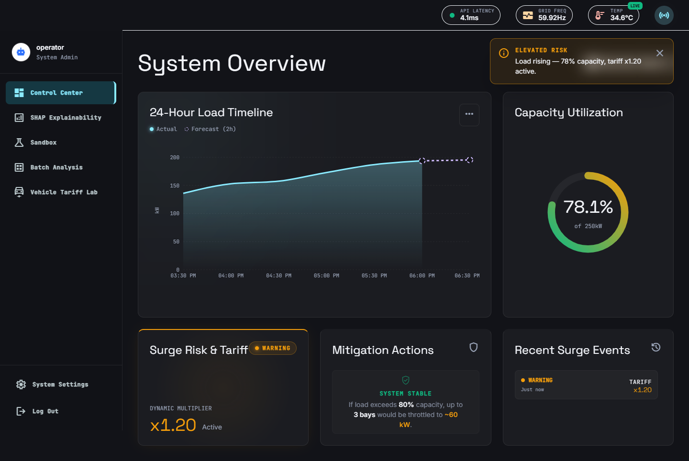
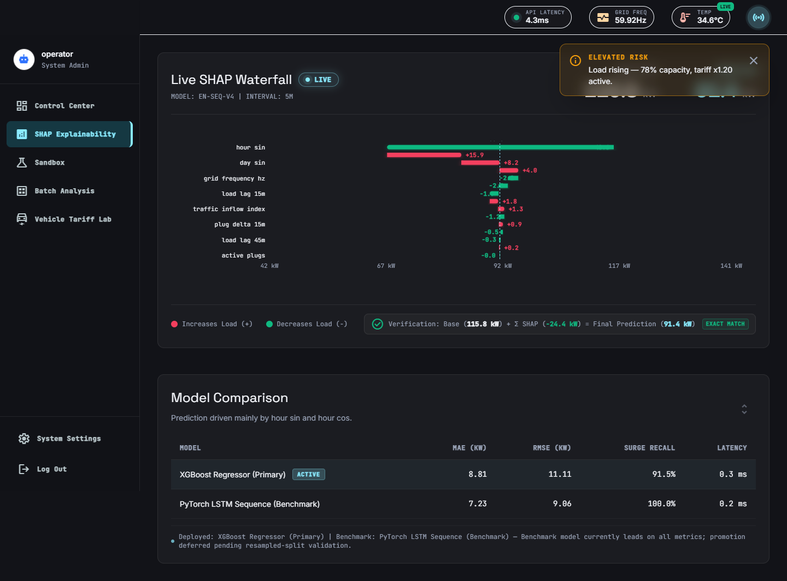
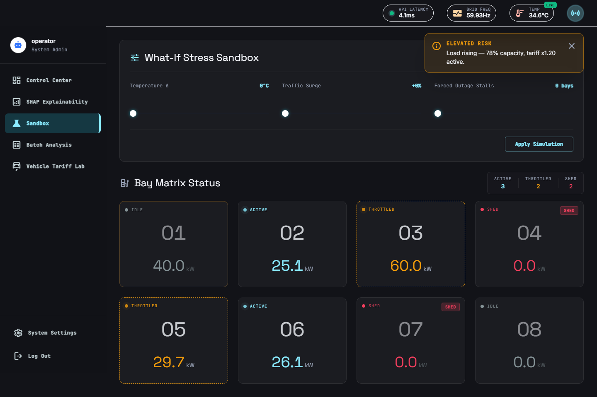
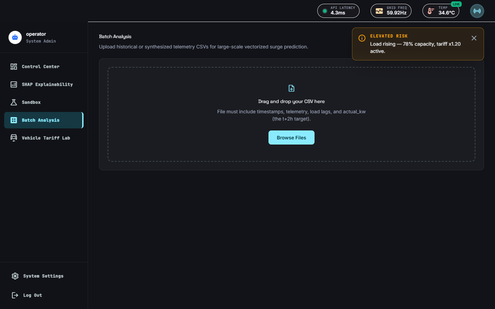
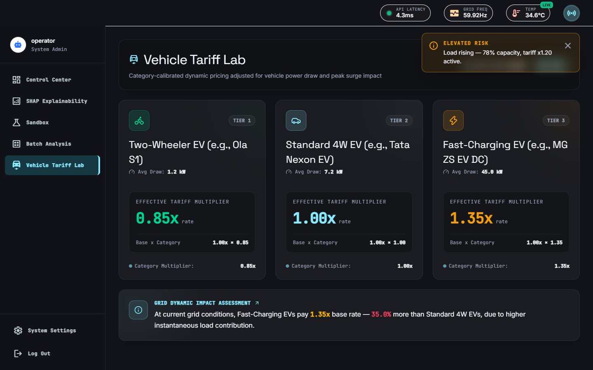
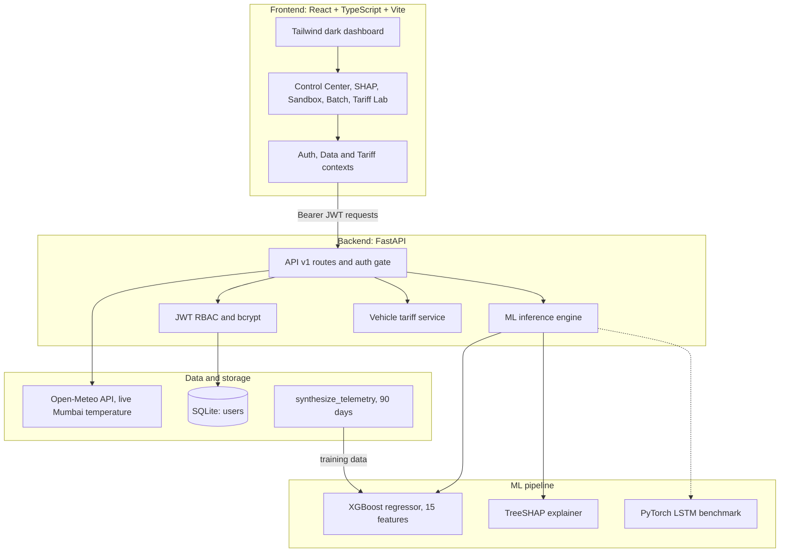

<div align="center">

# ⚡ EV Surge Predictor — Grid Pulse

**Predict EV charging load 2 hours ahead. Explain every prediction. Protect the transformer before it overloads.**

[](https://react.dev/)
[](https://www.typescriptlang.org/)
[](https://fastapi.tiangolo.com/)
[](https://xgboost.readthedocs.io/)
[](https://pytorch.org/)
[](https://tailwindcss.com/)
[](LICENSE)

[Overview](#-overview) · [Screenshots](#-screenshots) · [Features](#-features) · [Architecture](#-architecture) · [Model Results](#-model-results) · [Data Transparency](#-data-transparency) · [Setup](#-local-setup) · [API](#-api-reference) · [Team](#-team)

</div>

---

## 🎯 Overview

Commercial EV charging stations can draw enough power in a short window to overload their transformer. **Grid Pulse** is a full-stack system that forecasts station load **2 hours ahead**, explains *why* the model predicted it, and recommends (or simulates) protective actions such as dynamic tariffs, bay throttling, and load shedding.

| | |
|---|---|
| **Problem** | Sudden EV charging surges can breach the 250 kW transformer limit |
| **Solution** | 2-hour-ahead forecasting, surge risk banding, explainable predictions, and demand-response tariffs |
| **Models** | XGBoost (deployed) with TreeSHAP, PyTorch LSTM (benchmark) |
| **Stack** | React + TypeScript + Tailwind, FastAPI, SQLite, JWT auth |
| **Context** | Bhavan's College, CIA-2 project (BH.USCS.MAJ501) |

**Surge risk bands (against 250 kW capacity):** 🟢 Normal below 65% · 🟡 Warning 65 to 80% · 🔴 Critical at 80% or above (200 kW)

---

## 📸 Screenshots

### Control Center: live forecast, capacity gauge, surge risk and tariff


### SHAP Explainability: why the model predicted this number


### Sandbox: what-if stress testing


### Batch Analysis: CSV upload and bulk 2-hour-ahead prediction


### Vehicle Tariff Lab: category-based demand-response pricing


---

## 🚀 Features

### 1. Control Center
- 24-hour load timeline with actual load and a 2-hour-ahead forecast
- Capacity utilization gauge against the 250 kW transformer limit
- Surge risk status with a dynamic tariff multiplier
- Mitigation panel showing throttled bays, or a readiness preview when load is normal
- Recent surge event log

### 2. SHAP Explainability
- TreeSHAP waterfall: base value to final prediction, one bar per feature
- Additivity check in the UI: base value + sum of 15 SHAP values = model prediction
- Auto-generated sentence naming the top contributing drivers
- XGBoost vs LSTM comparison table (MAE, RMSE, surge recall, latency)

### 3. Sandbox (what-if simulation)
- Sliders for temperature change, traffic surge percentage, and forced stall outages (0 to 8 bays)
- Backend simulation returns baseline vs simulated load and the mitigation dispatched
- 8-bay status matrix: Active, Throttled, Shed, Idle
- Control Center switches to a clearly marked "Simulation Active" view while a scenario is applied

### 4. Batch Analysis
- Upload a telemetry CSV and get vectorized predictions for every row
- Summary stats, actual vs predicted chart (aligned to the 2-hour horizon), and a results table
- Download the annotated results as CSV

### 5. Vehicle Tariff Lab
Demand-response pricing by vehicle category, linked to the current surge state:

| Tier | Vehicle | Multiplier | Average draw |
|---|---|---|---|
| 1 | Two-wheeler EV | 0.85x | 1.2 kW |
| 2 | Standard 4W EV | 1.00x | 7.2 kW |
| 3 | DC fast charging | 1.35x | 45 kW |

### 6. Security and reporting
- JWT authentication (HS256) with bcrypt password hashing
- Role-based access control: **Operator** (full access) and **Viewer** (read-only), enforced on the backend and not only hidden in the UI
- One-click PDF report of the dashboard snapshot

---

## 🏗️ Architecture



---

## 📊 Model Results

Evaluated on the same held-out split (1,726 samples) from the 90-day feature pipeline.

| Metric | XGBoost (deployed) | PyTorch LSTM (benchmark) |
|---|---|---|
| MAE | 8.81 kW | **7.23 kW** |
| RMSE | 11.11 kW | **9.06 kW** |
| Surge recall | 91.5% | **100%** |
| Inference latency | 0.3 ms / sample | 0.2 ms / sample |
| Explainability | **Exact TreeSHAP** | Black box |

> **Why XGBoost is deployed:** the LSTM scores slightly better on raw metrics, but XGBoost gives exact TreeSHAP attributions, which matter for auditable grid decisions. Promoting the LSTM is deferred until multi-split temporal validation is done.

---

## 🔍 Data Transparency

| Signal | Source |
|---|---|
| Ambient temperature | **Live and real**, from the Open-Meteo API for Mumbai (19.0760 N, 72.8777 E), cached 10 minutes |
| Charging load, traffic index, grid frequency, active plugs | **Synthetic**, generated by `synthesize_telemetry()` |

Detailed public EV charging data for India is not available, so 90 days of 15-minute telemetry (8,640 timestamps) were synthesized with realistic daily commuting patterns and temperature dependence. The dashboard's "live" feed is a continuously updating simulation of this kind; only temperature comes from a real external source.

**15 engineered features:** ambient temperature, traffic inflow index, active plugs, plug delta (15 min), grid frequency, load lags (15, 30, 45, 60 min), rolling mean and std (60 min), and cyclical time encodings (hour and day, sin and cos).

---

## 💻 Local Setup

**Prerequisites:** Python 3.11+, Node.js 18+

### 1. Clone
```bash
git clone https://github.com/soham-88/ev-surge-predictor.git
cd ev-surge-predictor
```

### 2. Backend
```bash
cd backend
python -m venv venv

# Windows (PowerShell)
.\venv\Scripts\activate
# macOS / Linux
# source venv/bin/activate

pip install -r requirements.txt

# Environment variables (Windows: copy .env.example .env)
cp .env.example .env

# Optional: retrain the models
python pipeline/train.py

python -m uvicorn app.main:app --port 8000 --reload
```
API docs: http://127.0.0.1:8000/docs

### 3. Frontend (new terminal)
```bash
cd frontend
npm install
cp .env.example .env     # Windows: copy .env.example .env
npm run dev
```
Open http://localhost:5173

### Demo accounts
Seeded automatically on first backend startup:

| Role | Username | Password | Access |
|---|---|---|---|
| Operator | `operator` | `operatorpassword123` | Full access, including Sandbox simulation |
| Viewer | `viewer` | `viewerpassword123` | Read-only |

These are demo credentials for local use only.

---

## 📡 API Reference

<details>
<summary><b>Click to expand all endpoints</b></summary>

| Method | Endpoint | Access | Description |
|---|---|---|---|
| GET | `/health` | Public | Health check |
| POST | `/api/v1/auth/login` | Public | Login, returns JWT and role |
| GET | `/api/v1/auth/me` | Authenticated | Current user and role |
| POST | `/api/v1/predict` | Authenticated | 2-hour-ahead load prediction and surge risk |
| POST | `/api/v1/explain` | Authenticated | TreeSHAP feature attributions |
| POST | `/api/v1/simulate` | Operator | What-if grid stress simulation |
| GET | `/api/v1/metrics` | Authenticated | XGBoost and LSTM evaluation metrics |
| POST | `/api/v1/predict/batch` | Authenticated | Batch CSV prediction |
| GET | `/api/v1/predict/batch/download/{batch_id}` | Authenticated | Download annotated results CSV |
| GET | `/api/v1/tariff/vehicle-options` | Authenticated | Vehicle categories and specs |
| POST | `/api/v1/tariff/vehicle-adjusted` | Authenticated | Vehicle-adjusted tariff rate |
| GET | `/api/v1/weather/current` | Authenticated | Live temperature from Open-Meteo |

</details>

---

## 📂 Project Structure

```text
ev-surge-predictor/
├── backend/
│   ├── app/
│   │   ├── main.py            # FastAPI entry, CORS, startup seeding
│   │   ├── api/v1/            # predict, explain, simulate, auth, batch routes
│   │   ├── core/              # config, database, JWT security, weather service
│   │   ├── models/            # ML inference engine, user model
│   │   ├── routers/           # tariff router
│   │   ├── schemas/           # Pydantic schemas
│   │   └── services/          # vehicle tariff logic
│   ├── pipeline/              # train.py, train_lstm.py, benchmark_models.py
│   └── saved_models/          # trained artifacts and metrics
├── frontend/
│   └── src/
│       ├── components/        # ForecastTimeline, ShapWaterfall, StressSandbox, StallGrid
│       ├── context/           # Auth, Data, Tariff contexts
│       ├── pages/             # ControlCenter, ShapPage, SandboxPage, BatchAnalysis, VehicleTariffLab
│       ├── services/api.ts    # API client with JWT handling
│       └── types/             # TypeScript models
└── docs/                      # screenshots, audit report, specification
```

---

## 🗺️ Roadmap

- [ ] Real-time WebSocket telemetry instead of polling
- [ ] Walk-forward temporal cross-validation for the LSTM
- [ ] OCPP 2.0.1 integration for real charger throttling
- [ ] Docker Compose for one-command setup
- [ ] Automated tests (pytest, Vitest) and a CI workflow
- [ ] Cloud deployment with a public demo link

---

## 👥 Team

Built as a team project at **Bhavan's College, Mumbai** (CIA-2, Course Code BH.USCS.MAJ501).

| Name |
|---|
| **Soham Pawar** ([@soham-88](https://github.com/soham-88)) |
| Suryaprakash Pati |
| Gaurav Kanojiya |
| Madhur Kushwaha |
| Georgina Varghese |

---

<div align="center">

Released under the [MIT License](LICENSE).

</div>
